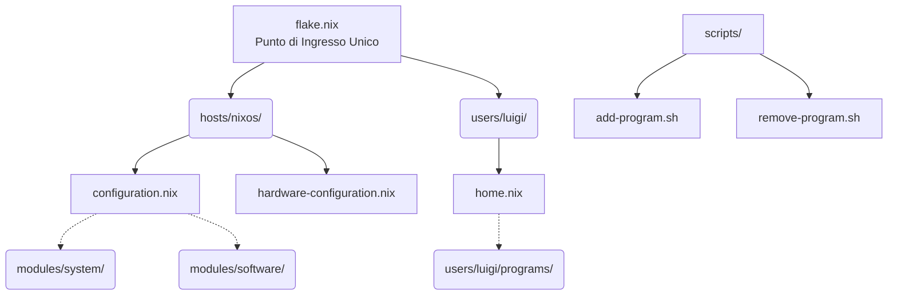

# 📘 Guida Architettura NixOS (Il Metodo "Veteran")

Benvenuto nel tuo sistema NixOS. Questa configurazione non è un banale copia-incolla di file sparsi, ma un'architettura **modulare, scalabile e gestita professionalmente** che segue rigorosamente le Best Practice della community NixOS.

Questa guida ti servirà per ricordarti come funziona il sistema sotto il cofano e come espanderlo senza rompere nulla.

---

## 🏗️ 1. Struttura Generale

Tutto il tuo sistema operativo è contenuto dentro `/etc/nixos/` ed è sotto controllo di versione tramite Git. 



### La Filosofia della Separazione:
- **`hosts/nixos/`**: Contiene solo le informazioni strettamente legate all'hardware di questo specifico computer. Se comprerai un portatile, creerai `hosts/laptop/`.
- **`modules/system/`**: L'infrastruttura di base. Qui dentro c'è il bootloader, i driver audio (PipeWire), la rete (NetworkManager) e i demoni che devono girare in background a livello di sistema.
- **`modules/software/`**: I pacchetti base di sistema (strumenti da riga di comando che servono anche all'utente `root`, come vim, wget, curl).
- **`users/luigi/`**: Il **REGNO DI HOME MANAGER**. Tutto ciò che è un programma utente (es. WezTerm, Firefox, Zsh, Git) vive qui, configurato esattamente come piace a te.

---

## 🚀 2. Gestione Software (Home Manager)

Per mantenere il sistema pulito e prevenire "disinstallazioni fantasma" quando usi più profili, usiamo la **Filosofia 1**: i programmi per l'utente finale non vengono installati globalmente, ma tramite Home Manager.

Nella cartella `users/luigi/programs/` c'è un file speciale chiamato `default.nix`.
Questo file agisce da **Registro Centralizzato**:

```nix
{
  imports = [
    ./bat.nix
    ./firefox.nix
    ./wezterm.nix
    # etc...
  ];
}
```
Invece di modificare questo file a mano o creare manualmente i file `.nix`, abbiamo creato un sistema di **automazione tramite script**!

---

## ❓ 3. FAQ: Come si fa? (Cheat Sheet)

### D: Come installo un nuovo programma? (es. `htop`, `vscode`, `spotify`)
**R:** Apri il terminale in una qualsiasi cartella e usa il tuo comando alias magico:
```bash
add-program nomeprogramma
```
*Cosa succede in background?*
1. Crea un file template in `users/luigi/programs/nomeprogramma.nix`.
2. Aggiunge il file al registro `default.nix`.
3. Controlla se per caso lo avevi installato nei file di sistema in `modules/software/` e, se lo trova, lo disinstalla da lì per evitare doppioni!
4. Salva la modifica su Git in automatico.

A questo punto apri il file appena creato, scrivi i tuoi config (se ne hai), e lancia `rebuild`.

### D: Come rimuovo un programma che non mi serve più?
**R:** Apri il terminale e digita:
```bash
rm-program nomeprogramma
```
*Cosa succede in background?*
1. Cancella il file da `users/luigi/programs/`.
2. Lo rimuove dal registro `default.nix`.
3. Registra la disinstallazione su Git.

Dopo lancia `rebuild` e il programma sparirà letteralmente dall'esistenza sul tuo PC.

### D: Come installo/rimuovo un SERVIZIO DI SISTEMA? (es. `docker`, `postgresql`)
**R:** Esattamente come i programmi, ma usando gli script per i servizi:
```bash
add-service nomeservizio
rm-service nomeservizio
```
Questi comandi andranno a scrivere nella cartella `modules/system/services/` invece che nella tua cartella utente.

### D: Qual è la differenza tra "Programmi" e "Servizi", e dove li metto? (Privilegi e Granularità)
**R:** Questa è la regola d'oro di NixOS e Linux:
1. **I Programmi (Home Manager):** Vivono nello *Spazio Utente*. Firefox, Zsh, WezTerm o Espanso funzionano **solo** quando l'utente Luigi ha fatto il login. Girano con i permessi di Luigi. Se hai segreti o configurazioni che non vuoi condividere con un utente ospite, usa Home Manager (`add-program`). *Nota: Home Manager può anche gestire servizi in background (come un demone per sincronizzare file personali), ma si spegneranno al tuo log-out.*
2. **I Servizi di Sistema (NixOS systemd):** Vivono nello *Spazio di Sistema*. OpenSSH, Docker o Keyd hanno permessi di amministratore (`root`). Si avviano prima ancora del login e agiscono a livello globale (su tutto l'hardware o la rete). Usa `add-service` solo per demoni infrastrutturali globali. Se vuoi limitare chi può usarli, userai i *Gruppi* di Linux (es. solo chi è nel gruppo `docker` può usare i container).

### D: Cosa faccio se voglio aggiungere un altro utente (es. un profilo "Ospite")?
**R:** 
1. Crea un file `users/ospite/system.nix` e definisci l'account (come hai fatto in `users/luigi/system.nix`).
2. Mettilo in `configuration.nix`.
3. Se vuoi che abbia dei programmi grafici di base, crea `users/ospite/home.nix` e dichiarali lì dentro. Questo ti assicurerà che l'utente Ospite non abbia accesso al tuo WezTerm customizzato o al tuo Git privato!

---

## 📝 4. Alias Salvati

Abbiamo salvato i seguenti alias in Zsh per renderti la vita facilissima:
- `rebuild`: Aggiorna e compila il sistema (richiede sudo per te).
- `conf`: Ti teletrasporta istantaneamente nella cartella `cd /etc/nixos/users/luigi/`.
- `cl`: Pulisce lo schermo (`clear`).
- `add-program` / `rm-program`: Crea/rimuovi programmi in Home Manager.
- `add-service` / `rm-service`: Crea/rimuovi servizi di sistema.
- `Alt + Frecce`: Per muoversi agilmente tra le parole nel terminale.
