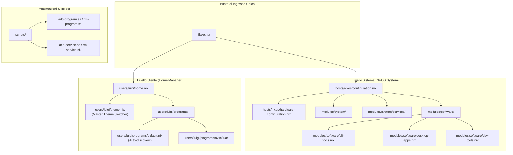
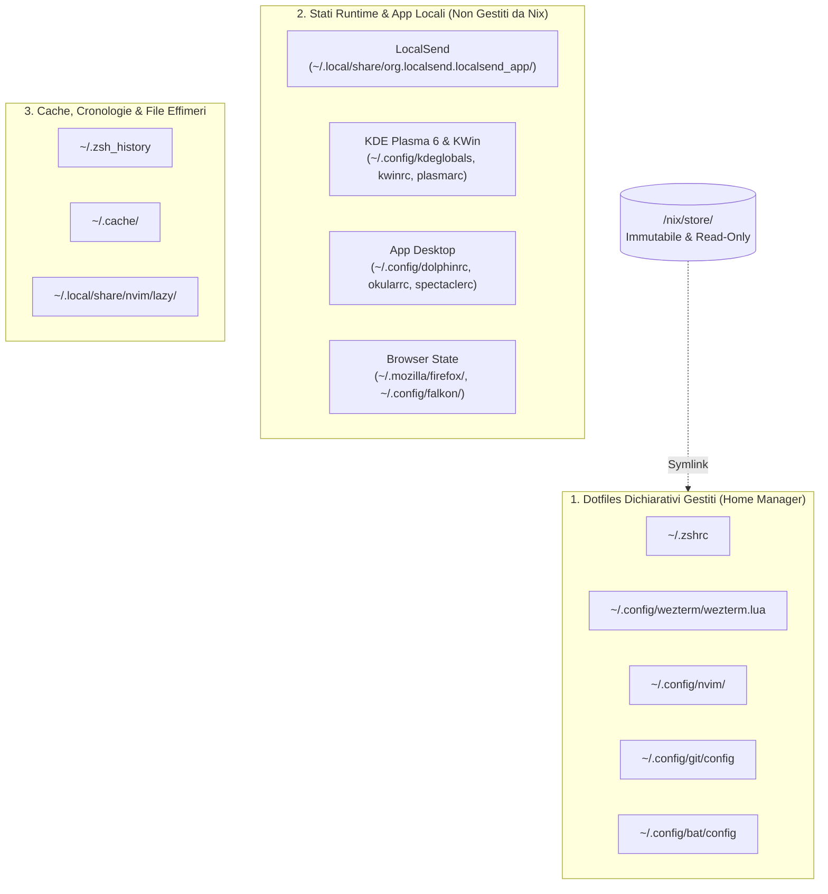
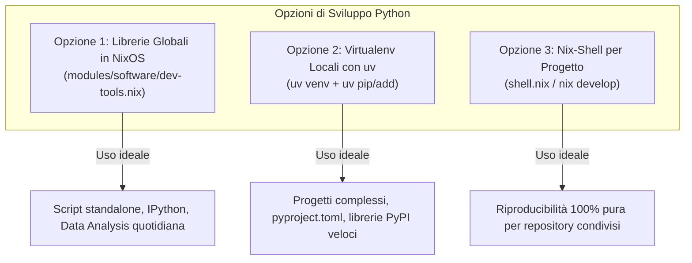
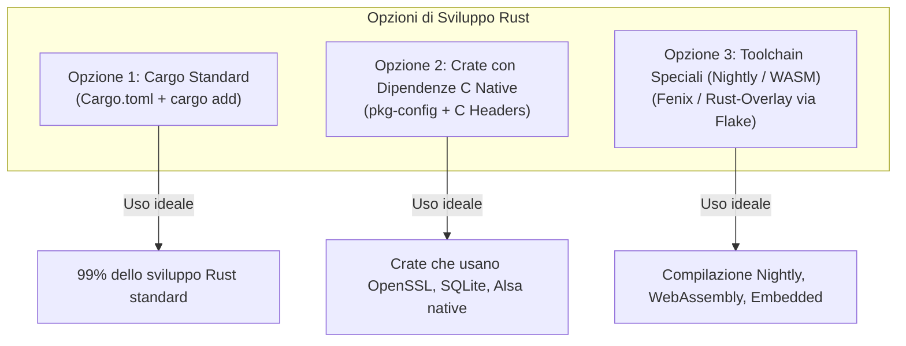

# 📘 Guida Completa all'Architettura NixOS & Gestione Configurazioni

Benvenuto nel tuo sistema NixOS. Questa configurazione segue un'architettura **modulare, scalabile, trasparente e conforme al principio KISS ("Keep It Simple, Stupid")**, senza metalinguaggi oscuri o script fragili.

Questa guida documenta la struttura del sistema, come gestire pacchetti e servizi, il sistema di theming centralizzato e la gestione dei file di configurazione (gestiti centralmente da Home Manager vs stati mutabili locali come LocalSend o KDE Plasma).

---

## 🏗️ 1. Mappa dell'Architettura

Tutto il sistema operativo è contenuto dentro `/etc/nixos/` (collegato tramite symlink anche a `~/nixos`) ed è versionato con Git.



### Separazione delle Responsabilità:
- **[`flake.nix`](../flake.nix)**: Il punto di ingresso dichiarativo con blocco Flakes e integrazione Home Manager.
- **`hosts/nixos/`**: Configurazione legata all'hardware di questo specifico PC.
- **`modules/system/`**: Bootloader, PipeWire audio, NetworkManager, SDDM e servizi di sistema.
- **`modules/system/services/`**: Demoni di sistema (OpenSSH, keyd, udisks2, gvfs) con **auto-importing automatico**.
- **`modules/software/`**: Pacchetti di sistema suddivisi logicamente (`cli-tools.nix`, `desktop-apps.nix`, `dev-tools.nix`).
- **`users/luigi/`**: Configurazione utente Home Manager (dotfiles, terminale, shell, editor e theming).
- **`scripts/`**: Helper CLI leggeri e sicuri per creare/rimuovere moduli senza modificare file manualmente.

---

## 📦 2. Gestione Software: Aggiungere e Rimuovere Programmi

Il sistema adotta un'unica e trasparente **Sorgente di Verità (Single Source of Truth)**.

### Caso A: Installare un Programma Semplice (99% dei casi)
Per installare utility come `vlc`, `fastfetch`, `gimp`, `htop`, `tmux`, ecc., **non serve creare nuovi file .nix**. 

Basta aprire il file della categoria desiderata in `modules/software/` e aggiungere il nome del pacchetto all'elenco:

| Categoria | File | Esempi di Pacchetti |
| :--- | :--- | :--- |
| **Strumenti CLI & Terminale** | [`modules/software/cli-tools.nix`](../modules/software/cli-tools.nix) | `ripgrep`, `fd`, `fastfetch`, `htop`, `ffmpeg` |
| **Applicazioni Desktop GUI** | [`modules/software/desktop-apps.nix`](../modules/software/desktop-apps.nix) | `vlc`, `gimp`, `obsidian`, `discord`, `mpv` |
| **Strumenti di Sviluppo & Compilatori** | [`modules/software/dev-tools.nix`](../modules/software/dev-tools.nix) | `clang`, `gdb`, `valgrind`, `rustc`, Python Stack |
| **Pacchetti Solo-Utente** | [`users/luigi/home.nix`](../users/luigi/home.nix) | Pacchetti in `home.packages` |

Dopo aver salvato, applica con:
```bash
rebuild
```

---

### Caso B: Creare un Modulo Programma Configurato (Home Manager)
Per programmi che richiedono configurazioni personalizzate, plugin o dotfiles specifici (es. `tmux`, `zsh`, `wezterm`, `neovim`):

Grazie all'**Auto-Discovery** presente in [`users/luigi/programs/default.nix`](../users/luigi/programs/default.nix), qualunque file `.nix` inserito nella cartella `programs/` viene importato automaticamente da Home Manager. **Non devi mai toccare `default.nix`**.

Puoi usare i comandi helper:

```bash
# 1. Crea lo scheletro del modulo e lo traccia in Git:
add-program tmux

# 2. (Opzionale) Modifica users/luigi/programs/tmux.nix per aggiungere opzioni

# 3. Rimuove il modulo e ne programma la cancellazione:
rm-program tmux
```

Per i servizi di sistema:
```bash
add-service syncthing    # Crea modules/system/services/syncthing.nix
rm-service syncthing     # Rimuove modules/system/services/syncthing.nix
```

---

## 🎨 3. Il Sistema di Theming Centralizzato (1 Single Line Switch)

Il theming del tuo ambiente è governato da un master switch in [`users/luigi/theme.nix`](../users/luigi/theme.nix).

### Come Cambiare Stile
Apri [`users/luigi/theme.nix`](../users/luigi/theme.nix) e decommenta **UNA** sola riga:

```nix
# ==============================================================================
# Global Theme Switcher
# Uncomment ONE line to set the active style across WezTerm, Neovim, Zsh, & Bat:
# ==============================================================================
"tokyonight"   # Stile 1: High-Contrast Solid (Tokyo Night, Opacità 1.0, Neovim Solido, Prompt RobbyRussell)
# "catppuccin" # Stile 2: Translucent Aesthetic (Catppuccin Mocha, Opacità 0.80, Neovim Trasparente, Prompt Flottante)
```

Poi esegui `rebuild`. In un solo colpo cambieranno:
1. **WezTerm** ([`wezterm.nix`](../users/luigi/programs/wezterm.nix)): Opacità della finestra (1.0 solido vs 0.80 vetro) e palette colori.
2. **Neovim** ([`nvim/lua/plugins/theme.lua`](../users/luigi/programs/nvim/lua/plugins/theme.lua)): Colori e trasparenza letti tramite la variabile standard `vim.g.theme_style`.
3. **Zsh** ([`zsh.nix`](../users/luigi/programs/zsh.nix)): Prompt `robbyrussell` pulito e ad alto contrasto vs prompt casuale.
4. **Bat** ([`bat.nix`](../users/luigi/programs/bat.nix)): `TwoDark` ad alto contrasto vs `Catppuccin Mocha`.

---

## 🔍 4. Anatomia delle Configurazioni: File Gestiti vs Stati Locali

Nel tuo sistema Linux coesistono tre categorie distinte di file di configurazione e dati nella cartella home (`~`):



---

### Categoria 1: Dotfiles Centralizzati e Immutabili (Home Manager)
- **Cosa sono**: Configurazioni generate direttamente da NixOS in `/etc/nixos/users/luigi/programs/`.
- **Come vivono nel disco**: Sono **symlink** che puntano dentro `/nix/store/...` (in sola lettura).
  - `~/.zshrc` -> `/nix/store/...-home-manager-files/.zshrc`
  - `~/.config/wezterm/wezterm.lua` -> `/nix/store/...-home-manager-files/.config/wezterm/wezterm.lua`
  - `~/.config/nvim/lua` -> `/nix/store/...-home-manager-files/.config/nvim/lua`
  - `~/.config/git/config` -> `/nix/store/...-home-manager-files/.config/git/config`
  - `~/.config/bat/config` -> `/nix/store/...-home-manager-files/.config/bat/config`
- **Regole Fondamentali**:
  - ❌ **Non modificarli a mano dentro `~/.config/`**: Qualunque modifica manuale verrebbe sovrascritta al prossimo `rebuild`.
  - ✅ **Modificali in `/etc/nixos/users/luigi/`**: Cambia il file sorgente in Nix/Lua e lancia `rebuild`.

---

### Categoria 2: Stati Runtime & App Non Gestite Centralmente (es. LocalSend, Plasma 6)
- **Cosa sono**: Applicazioni che memorizzano stati dinamici, chiavi crittografiche, abbinamenti di rete o preferenze grafiche direttamente durante l'utilizzo.

#### Il caso di **LocalSend**:
- LocalSend salva i propri dati in `~/.local/share/org.localsend.localsend_app/`.
- **Cosa contiene**:
  - Chiavi TLS e certificati locali per il trasferimento file sicuro.
  - Abbinamento dispositivi fidati sulla rete locale (LAN).
  - Cronologia dei trasferimenti e cartella di download predefinita.
- **Perché NON è gestito in Nix**: Se LocalSend fosse vincolato a un file immutabile in `/nix/store`, l'applicazione non potrebbe generare certificati dinamici né ricordare i dispositivi associati a runtime.

#### Il caso di **KDE Plasma 6 & KWin**:
- I file di Plasma (come `~/.config/kdeglobals`, `~/.config/kwinrc`, `~/.config/plasma-org.kde.plasma.desktop-appletsrc`, `~/.config/kglobalshortcutsrc`):
  - Sono modificati continuamente dal server grafico (spostamento widget, ridimensionamento finestre, regole monitor in `kwinoutputconfig.json`).
  - Rimangono file locali scrivibili per consentire a Plasma di salvare lo stato senza andare in conflitto con i link immutabili di Nix.

#### Il caso di altre App GUI (Dolphin, Spectacle, Okular, MPV, Firefox):
- `~/.config/dolphinrc`: Posizione pannelli e modalità di visualizzazione cartelle.
- `~/.config/spectaclerc`: Scorciatoie e impostazioni OCR dello strumento screenshot.
- `~/.mozilla/firefox/`: Cookie, sessioni aperte, credenziali salvate nel password manager.

---

### Categoria 3: Cache, Cronologie e Dati Temporanei
- **`~/.zsh_history`**: Il registro dei comandi eseguiti nella shell (file mutabile, append-only).
- **`~/.cache/`**: Cache delle miniature, font, bat cache (`bat.bin`), shader GPU.
- **`~/.local/share/nvim/lazy/`**: Repository Git dei plugin di Neovim scaricati da LazyVim.
- **Caratteristica**: Possono essere cancellati in qualsiasi momento; verranno rigenerati automaticamente dal sistema o dai programmi.

---

### 🛡️ Protezione Automatica Conflitti (`backupFileExtension = "backup"`)
In [`flake.nix`](../flake.nix) è configurata la direttiva:
```nix
home-manager.backupFileExtension = "backup";
```
Se un programma genera un file regolare in `~/.config` che entra in collisione con un nuovo modulo Home Manager, Home Manager rinomina automaticamente il file vecchio in `.backup` invece di bloccare il build del sistema.

---

## 🛠️ 5. Gestione Librerie & Linguaggi di Programmazione (Python, Rust, C/C++)

In NixOS, la gestione delle librerie per lo sviluppo software segue logiche specifiche per evitare conflitti e garantire la riproducibilità. Ecco le opzioni disponibili per ciascun ecosistema.

---

### 🐍 Python: Le 3 Opzioni a Confronto



#### Opzione 1: Librerie Globali Dichiarative in NixOS (Per utility e analisi quotidiana)
Se usi librerie frequentemente da riga di comando o in sessioni interattive con `ipython`, puoi dichiararle globalmente in [`modules/software/dev-tools.nix`](../modules/software/dev-tools.nix):

```nix
  (python3.withPackages (ps: with ps; [
    requests
    rich
    pandas
    polars
    numpy
    scipy
    scikit-learn
    matplotlib
    seaborn
    ipython
    # Aggiungi qui nuove librerie (es. ps.flask, ps.torch)
  ]))
```
*Vantaggio:* Disponibili istantaneamente ovunque nel sistema senza attivare venv.

#### Opzione 2: Virtual Environment con `uv` (Raccomandato per Progetti Reali)
Il tuo sistema ha **`uv`** e **`nix-ld`** già configurati. Questo ti permette di creare ambienti virtuali e installare qualunque wheel binario da PyPI a velocità istantanea:

```bash
# 1. Crea l'ambiente virtuale
uv venv

# 2. Attiva il venv
source .venv/bin/activate

# 3. Installa o aggiungi pacchetti (anche binari C/C++ come torch o polars)
uv pip install requests fastapi uvicorn
# oppure con pyproject.toml:
uv add fastapi
```
*Vantaggio:* Nessun inquinamento di Nix, massima compatibilità con l'ecosistema Python moderno, velocissimo.

#### Opzione 3: Shell Nix Ephemerale (`nix-shell`)
Per testare una libreria al volo senza modificare la configurazione di sistema e senza creare file sul disco:

```bash
nix-shell -p "python3.withPackages (ps: [ ps.aiohttp ps.playwright ])"
```

---

### 🦀 Rust: Le 3 Opzioni a Confronto

In NixOS, l'intero toolchain di base (`rustc`, `cargo`, `rust-analyzer`) è già installato a livello di sistema in [`modules/software/dev-tools.nix`](../modules/software/dev-tools.nix).



#### Opzione 1: Flusso Standard con Cargo (Il Metodo Standard)
Aggiungere librerie (crate) a un progetto Rust in NixOS funziona esattamente come su qualsiasi altra distribuzione Linux:

```bash
# 1. Crea il progetto
cargo new mio-progetto
cd mio-progetto

# 2. Aggiungi le librerie
cargo add serde --features derive
cargo add tokio --features full
cargo add axum
```
Cargo scaricherà i sorgenti in `~/.cargo/` e compilerà i binari in `./target/`.

#### Opzione 2: Crate con Dipendenze C Native (es. OpenSSL, SQLite)
Alcuni crate compilano codice C tramite bindgen (es. `openssl-sys`, `libsqlite3-sys`):
- Il sistema ha già `pkg-config`, `gcc` e `clang` installati globalmente in `dev-tools.nix`.
- Se un crate richiede header di una libreria C specifica:
  - **A livello di sistema**: aggiungi la libreria (es. `openssl.dev`) a [`dev-tools.nix`](../modules/software/dev-tools.nix).
  - **A livello di singolo progetto**: crea un file `shell.nix` nella cartella del progetto:
    ```nix
    { pkgs ? import <nixpkgs> {} }:
    pkgs.mkShell {
      nativeBuildInputs = with pkgs; [ pkg-config ];
      buildInputs = with pkgs; [ openssl ];
    }
    ```

#### Opzione 3: Toolchain Nightly o Target Esotici (WASM / Embedded)
Se un progetto richiede una versione specifica di Rust (es. `nightly` o target `wasm32-unknown-unknown`):
- Si usa un Flake con l'overlay **`fenix`** o **`rust-overlay`** all'interno del repository del progetto.

---

### 💻 C / C++: Header, Compilatori e LSP

Nel tuo sistema sono già installati:
- **Compilatori & Build System**: `gcc`, `clang`, `gnumake`, `cmake`, `ninja`.
- **LSP & Strumenti di Analisi**: `clang-tools` (`clangd` integrato con LazyVim), `valgrind`, `gdb`.
- **Librerie C installate**: `tesseract`, `libqalculate`, ecc.

Per sviluppare progetti in C (come le esercitazioni in `~/Programming/OS/`):
- Puoi usare normali `Makefile` o `CMakeLists.txt`.
- `clangd` integrato in Neovim leggerà automaticamente i file `.c` e `.h` o il file `compile_commands.json` (generabile tramite `bear -- make`).

---

## ⚡ 6. Cheat Sheet dei Comandi

### Operazioni Quotidiane
```bash
# Applica tutte le modifiche alla configurazione (alias di sudo nixos-rebuild switch --flake /etc/nixos)
rebuild

# Entra direttamente nella directory di configurazione
conf

# Cerca un pacchetto nei repository Nixpkgs
nix search nixpkgs <nome>

# Esegui un programma al volo senza installarlo permanentemente
nix-shell -p <nome>
# oppure
nix run nixpkgs#<nome>

# Pulisci generazioni vecchie e libera spazio su disco
sudo nix-collect-garbage -d
```

### Gestione Moduli Rapida
```bash
# Crea un modulo programma in users/luigi/programs/<nome>.nix
add-program <nome>

# Rimuove un modulo programma
rm-program <nome>

# Crea un modulo servizio in modules/system/services/<nome>.nix
add-service <nome>

# Rimuove un modulo servizio
rm-service <nome>
```

---

*Guida aggiornata e sincronizzata con l'architettura attiva in `/etc/nixos`.*
