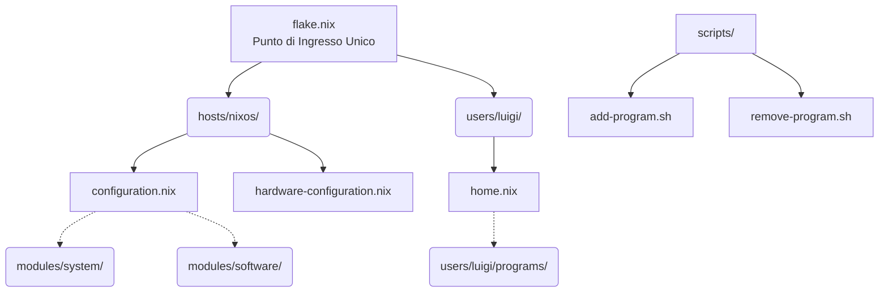

# 📘 Guida Architettura NixOS (Il Metodo "Veteran")

Benvenuto nel tuo sistema NixOS. Questa configurazione non è un banale copia-incolla di file sparsi, ma un'architettura **modulare, scalabile e gestita professionalmente** che segue rigorosamente le Best Practice della community NixOS.

Questa guida ti servirà per ricordarti come funziona il sistema sotto il cofano e come espanderlo senza rompere nulla.

---

## 🏗️ 1. Struttura Generale

Tutto il tuo sistema operativo è contenuto dentro `/etc/nixos/` ed è sotto controllo di versione tramite Git. 



### La Filosofia della Separazione:
- **`hosts/nixos/`**: Contiene solo le informazioni strettamente legate all'hardware di questo specifico computer. Se comprerai un portatile, creerai `hosts/laptop/`.
- **`modules/system/`**: L'infrastruttura di base. Qui dentro c'è il bootloader, i driver audio (PipeWire), la rete (NetworkManager) e i demoni che devono girare in background a livello di sistema.
- **`modules/software/`**: I pacchetti base di sistema (strumenti da riga di comando che servono anche all'utente `root`, come vim, wget, curl).
- **`users/luigi/`**: Il **REGNO DI HOME MANAGER**. Tutto ciò che è un programma utente (es. WezTerm, Firefox, Zsh, Git) vive qui, configurato esattamente come piace a te.

---

## 🚀 2. Gestione Software (Home Manager)

Per mantenere il sistema pulito e prevenire "disinstallazioni fantasma" quando usi più profili, usiamo la **Filosofia 1**: i programmi per l'utente finale non vengono installati globalmente, ma tramite Home Manager.

Nella cartella `users/luigi/programs/` c'è un file speciale chiamato `default.nix`.
Questo file agisce da **Registro Centralizzato**:

```nix
{
  imports = [
    ./bat.nix
    ./firefox.nix
    ./wezterm.nix
    # etc...
  ];
}
```
Invece di modificare questo file a mano o creare manualmente i file `.nix`, abbiamo creato un sistema di **automazione tramite script**!

---

## ❓ 3. FAQ: Gestione Software con `pacnix` (Il Metodo a Database)

Il sistema ora adotta l'architettura a **Database Centralizzato** (`refactoring/manifest.toml`) tramite la CLI **`pacnix`** (o l'alias breve `p`). 
Questo approccio garantisce:
- **Zero duplicazioni** tra System e Home Manager.
- **Ispezione istantanea** come in Pacman (`pacnix query`, `pacnix audit`).
- **Nessuna corruzione da script regex**: il codice Nix viene validato prima di essere generato.

### D: Come installo un nuovo programma?
**R:** Usa il comando `pacnix add` (o l'alias salvato `add-program`):
```bash
# Per un programma utente (es. fastfetch, btop)
pacnix add nomeprogramma

# Per un programma o utility di sistema (disponibile anche a root / rescue shell)
pacnix add nomeprogramma --scope system
```
*Cosa succede in background?*
1. Registra il pacchetto nel database centrale `refactoring/manifest.toml`.
2. Rileva automaticamente se il software richiede un modulo Home Manager (`programs.<name>`) o un pacchetto puro (`home.packages` o `environment.systemPackages`).
3. Verifica che non sia già fornito da Plasma 6 o dal sistema.
4. Rigenera in sicurezza i moduli Nix puliti.

Dopo lancia `rebuild` per applicare i cambiamenti.

### D: Come rimuovo un programma?
**R:** Usa `pacnix remove` (o l'alias `rm-program`):
```bash
pacnix remove nomeprogramma
```
E poi lancia `rebuild`.

### D: Come scopro cosa è installato e chi lo possiede? (Come `pacman`)
**R:**
```bash
# Lista tutti i programmi installati esplicitamente (come pacman -Qe):
pacnix query -e

# Ispeziona i dettagli, motivo e dotfiles di un pacchetto (come pacman -Qi):
pacnix query -i wezterm

# Scopri quale pacchetto possiede un file di configurazione (come pacman -Qo):
pacnix query -o ~/.config/wezterm/wezterm.lua

# Esegui un audit completo del sistema per scovare conflitti e duplicati:
pacnix audit
```

### D: Qual è la differenza tra "System" e "Home Manager", e dove metto i programmi?
**R:**
1. **Workstation / System (`--scope system`):** Tutti i binari generici (es. `ripgrep`, `gcc`, `git`, `curl`, `jq`, `mpv`) e gli strumenti che devono funzionare anche per l'utente `root`, nei demoni systemd o nelle shell di emergenza.
2. **User / Home Manager (`--scope user:luigi`):** Tutto ciò che contiene la tua **identità e personalizzazione profonda** (es. `wezterm` con i tuoi font/opacità, `git` con la tua email/chiavi, `zsh` con i tuoi prompt, `neovim` con i tuoi plugin).

---

## 📝 4. Alias Salvati

Abbiamo salvato i seguenti alias in Zsh per renderti la vita facilissima:
- `rebuild`: Aggiorna e compila il sistema (rileva dinamicamente la repo Git).
- `conf`: Ti teletrasporta istantaneamente nella cartella della configurazione.
- `cl`: Pulisce lo schermo (`clear`).
- `p` / `pacnix`: CLI del gestore database centralizzato.
- `audit`: Controlla lo stato di salute della configurazione e dei dotfiles (`pacnix audit`).
- `add-program` / `rm-program`: Alias intuitivi per `pacnix add` e `pacnix remove`.
- `Alt + Frecce`: Per muoversi agilmente tra le parole nel terminale.

