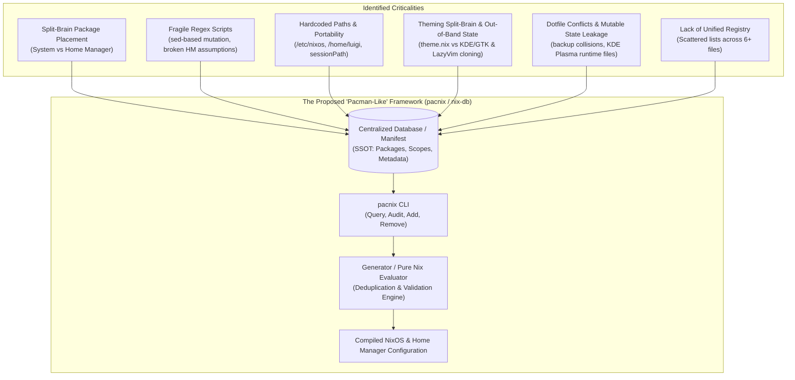
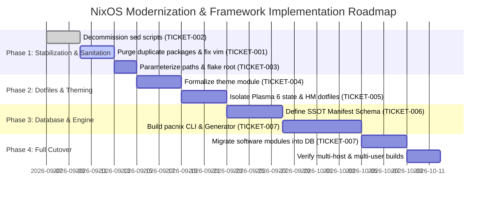

# NixOS Architecture Refactoring & Database-Driven Framework Roadmap

## 1. Executive Summary

This directory contains the in-depth architectural audit, criticality analysis, and engineering tickets for modernizing this NixOS configuration.

The ultimate objective is to combine:
1. **The benefits of a centralized, transactional database** (inspired by package managers like Arch Linux's `pacman` / ALPM):
   - A single source of truth (SSOT).
   - Clear distinction between explicitly installed packages (`--asexplicit`) and dependencies/system infrastructure (`--asdeps`).
   - Zero duplication and zero split-brain ambiguity across targets (system vs. user).
   - Fast, unified inspection and querying (`pacman -Qe`, `pacman -Qi`).
2. **The reproducibility and isolation of NixOS and Home Manager**:
   - Pure declarative configuration and atomic generational rollbacks.
   - Derivation hashing and store isolation.
   - Protection of mutable user dotfiles (`~/.config`) from uncoordinated clobbering.

---

## 2. Taxonomy of Identified Criticalities

A comprehensive audit of the active repository (`/etc/nixos` / `/home/luigi/nixos`) revealed 6 primary areas of criticality:

| Area | Severity | Core Issue | Real-world Impact |
| :--- | :---: | :--- | :--- |
| **Package Placement & Deduplication** | **HIGH** | Packages are arbitrarily split between `environment.systemPackages` (in 3 different files) and Home Manager (`home.packages` and `programs.*`). | Ghost packages, duplicate package instances in evaluation (`spectacle`, `bluedevil`, `man-db`, `zsh`), and missing tools in root (e.g., `git` missing while `gh` is installed). |
| **Imperative Scaffolding Scripts** | **CRITICAL** | `add-program.sh` uses regex `sed -i` to mutate files and assumes *every* package is a `programs.<name>` Home Manager module. | Running `add-program ripgrep` or `add-program gimp` corrupts Nix files or creates non-existent options, breaking `nixos-rebuild switch`. |
| **Path Hardcoding & Portability** | **MEDIUM-HIGH** | Absolute paths (`/etc/nixos`, `/home/luigi`) hardcoded across 8 different files and shell aliases. | Repository cannot be evaluated in alternative directories, on other machines, or during automated test/CI pipelines. |
| **Theming & Out-of-Band State** | **MEDIUM** | `theme.nix` is an untyped ad-hoc import affecting only 4 terminal tools. Neovim's LazyVim imperatively downloads plugins at runtime. | Switching themes desynchronizes the desktop (Plasma stays light/dark while terminal switches); Neovim violates Nix purity and breaks offline. |
| **Home Dotfiles & Mutable State** | **HIGH** | Home Manager's `.backup` strategy collides with KDE Plasma 6 writing directly to `~/.config`. | Risk of rebuild failures, clobbered runtime settings, or runaway `.backup` files. |
| **Centralization & Queryability** | **HIGH** | No unified way to inspect installed software, reason for installation, or ownership. | Configuration drift, lost visibility of system state, and lack of dependency hygiene. |

---

## 3. Index of Refactoring Tickets

The tickets in this directory are organized as self-contained engineering specifications:

| Ticket ID | Title | Focus Area | Status |
| :--- | :--- | :--- | :---: |
| [**TICKET-001**](./TICKET-001-audit-split-brain-and-package-duplication.md) | **Audit: System vs. User Package Placement & Record Duplication** | Eliminating package overlap, resolving `vim`/`neovim` shadowing, and establishing clear target boundaries. | **RESOLVED** |
| [**TICKET-002**](./TICKET-002-fragile-scripting-and-sed-mutation.md) | **Criticality: Destructive Regex Scripts & Broken Module Assumptions** | Decommissioning `sed -i` bash scripts, fixing the invalid `programs.<name>` assumption, and preventing dirty git commits. | **RESOLVED** |
| [**TICKET-003**](./TICKET-003-hardcoded-paths-and-portability.md) | **Criticality: Hardcoded Paths, Shell Aliases & Scalability** | Replacing hardcoded `/etc/nixos` with relative flake paths, dynamic environment variables, and multi-host readiness. | **RESOLVED** |
| [**TICKET-004**](./TICKET-004-split-brain-theming-and-desktop-state.md) | **Criticality: Theming Split-Brain & Neovim Out-of-Band State** | Unifying system and desktop theming with Stylix / Nix modules, and removing phantom Lua configs and runtime git cloning. | **RESOLVED** |
| [**TICKET-005**](./TICKET-005-home-managed-dotfiles-and-mutable-leakage.md) | **Criticality: Home Dotfile Management & Plasma 6 State Leakage** | Establishing clear boundaries between immutable Nix store links, managed mutable defaults, and unmanaged runtime caches. | **RESOLVED** |
| [**TICKET-006**](./TICKET-006-unified-database-architecture-rfc.md) | **RFC: The "Pacman Database" Architecture for NixOS** | Full architectural specification for a centralized registry, schema definitions, deduplication engine, and compiler pipeline. | **ADOPTED** |
| [**TICKET-007**](./TICKET-007-prototype-cli-and-migration-path.md) | **Framework Specification: `pacnix` CLI & Phased Migration Plan** | Detailed CLI design (`pacnix add`, `remove`, `query`, `audit`, `sync`), Python/Rust generator prototype, and 4-phase rollout plan. | **OPERATIONAL** |

---

## 4. Phased Implementation Roadmap

To begin reviewing, proceed to [TICKET-001](./TICKET-001-audit-split-brain-and-package-duplication.md).
