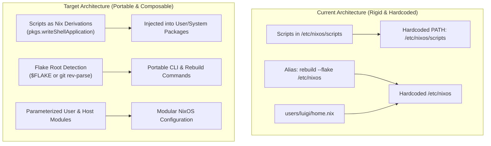

# TICKET-003: Criticality: Hardcoded Paths, Shell Aliases & Scalability

| Metadata | Details |
| :--- | :--- |
| **Ticket ID** | TICKET-003 |
| **Component** | Filesystem Structure, Shell Environment & Flake Integration |
| **Severity** | Medium-High |
| **Impact** | Breaks non-root local builds, multi-host expansion, multi-user isolation, and portable CI |
| **Status** | Resolved & Verified |

---

## 1. Problem Description

The configuration currently relies on hardcoded filesystem paths pointing to `/etc/nixos` and `/home/luigi`. This creates rigid coupling to a specific filesystem layout on a single host, violating the core NixOS principle of portable, relocatable declarative configurations.

---

## 2. In-Depth Audit of Hardcoded Paths

### A. Scripts & Shell Environment
1. **`home.sessionPath` in [users/luigi/home.nix:17-19](file:///home/luigi/nixos/users/luigi/home.nix#L17-L19)**:
   ```nix
   home.sessionPath = [
     "/etc/nixos/scripts"
   ];
   ```
   - Injects uncompiled, mutable bash scripts from `/etc/nixos/scripts` directly into `$PATH`.
   - If the repository is cloned elsewhere (e.g., `~/nixos`, `~/src/dotfiles`), the system continues running the stale scripts from `/etc/nixos/scripts`.
   - Bypasses Nix derivation wrapping, shellcheck linting, and runtime dependency closures.

2. **Shell Aliases in [users/luigi/programs/zsh.nix:34-35](file:///home/luigi/nixos/users/luigi/programs/zsh.nix#L34-L35)**:
   ```nix
   rebuild = "sudo nixos-rebuild switch --flake /etc/nixos";
   conf = "cd /etc/nixos/users/luigi";
   ```
   - Forces `nixos-rebuild switch` to always evaluate `/etc/nixos`, even if the user is developing in a feature branch inside `~/nixos`.
   - `conf` hardcodes the username `luigi` and assumes the repo lives in `/etc/nixos`.

3. **Scaffolding Scripts**:
   - [scripts/add-program.sh:11,51](file:///home/luigi/nixos/scripts/add-program.sh#L11)
   - [scripts/remove-program.sh:11,29](file:///home/luigi/nixos/scripts/remove-program.sh#L11)
   - [scripts/add-service.sh:11,40](file:///home/luigi/nixos/scripts/add-service.sh#L11)
   - [scripts/remove-service.sh:11,28](file:///home/luigi/nixos/scripts/remove-service.sh#L11)
   All explicitly hardcode:
   ```bash
   DIR="/etc/nixos/users/luigi/programs"
   cd /etc/nixos || exit 1
   ```

### B. Single-User & Single-Host Hardcoding
1. **Flake Output in [flake.nix:25](file:///home/luigi/nixos/flake.nix#L25)**:
   ```nix
   home-manager.users.luigi = import ./users/luigi/home.nix;
   ```
   - The user `luigi` is hardwired into the top-level flake.
   - Adding a laptop host (`hosts/laptop`) or another user (`users/alice`) requires copy-pasting boilerplate across `flake.nix` and `configuration.nix`.
2. **Hardcoded User Home in [users/luigi/home.nix:4-5](file:///home/luigi/nixos/users/luigi/home.nix#L4-L5)**:
   ```nix
   home.username = "luigi";
   home.homeDirectory = "/home/luigi";
   ```
   - Should be parameterized via `config.users.users.<name>.home` or passed as a flake argument.

### C. Redundant Environment Variables
In [modules/software/cli-tools.nix:40-46](file:///home/luigi/nixos/modules/software/cli-tools.nix#L40-L46):
```nix
  environment.sessionVariables = {
    TESSDATA_PREFIX = "/run/current-system/sw/share/tessdata";
  };
  environment.variables = {
    TESSDATA_PREFIX = "/run/current-system/sw/share/tessdata";
  };
```
- Exactly the same variable is declared twice under two different options.
- Relies on a hardcoded path in `/run/current-system` rather than referencing the package derivation directly (`"${pkgs.tesseract}/share/tessdata"`).

---

## 3. Proposed Refactoring Architecture



### Key Improvements:
1. **Packaging Scripts as Derivations**:
   Convert scripts in `scripts/` into first-class Nix derivations using `pkgs.writeShellApplication` with proper `runtimeInputs` (`git`, `nix`, `coreutils`). This removes `/etc/nixos/scripts` from `$PATH`.
2. **Dynamic Flake Path Discovery**:
   Replace the hardcoded `/etc/nixos` in aliases and scripts with a smart resolver:
   ```bash
   FLAKE_DIR="${NIXOS_CONFIG_DIR:-$(git rev-parse --show-toplevel 2>/dev/null || echo /etc/nixos)}"
   ```
3. **Pure Nix Derivation References**:
   Replace `/run/current-system/sw/share/tessdata` with direct derivation interpolations:
   ```nix
   environment.sessionVariables = {
     TESSDATA_PREFIX = "${pkgs.tesseract}/share/tessdata";
   };
   ```

---

## 4. Acceptance Criteria

- [x] `/etc/nixos/scripts` is completely removed from `home.sessionPath`.
- [x] CLI tooling (`pacnix`) is converted to a Nix derivation and managed via `environment.systemPackages`.
- [x] `rebuild` and `conf` aliases honor `$NIXOS_CONFIG_DIR` or current repository location before falling back to `/etc/nixos`.
- [x] `TESSDATA_PREFIX` is deduplicated and references `${tesseractWithLangs}` directly.
- [x] Flake can be cleanly evaluated from an arbitrary directory path (`nix eval /path/to/repo#nixosConfigurations.nixos`).
