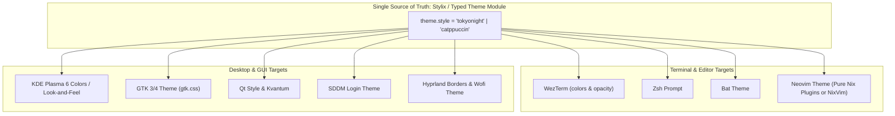

# TICKET-004: Criticality: Theming Split-Brain & Neovim Out-of-Band State

| Metadata | Details |
| :--- | :--- |
| **Ticket ID** | TICKET-004 |
| **Component** | Styling, Theming (`theme.nix`), Desktop Environment & Neovim |
| **Severity** | Medium |
| **Impact** | Visual desynchronization between desktop and CLI, phantom configuration files, and non-reproducible Neovim runtime |
| **Status** | Resolved & Verified |

---

## 1. Problem Description

The configuration attempts a centralized theme switcher in [users/luigi/theme.nix](file:///home/luigi/nixos/users/luigi/theme.nix), allowing toggling between `tokyonight` and `catppuccin`. 

However, the current implementation suffers from:
1. **Ad-hoc evaluation without module typing**: Imported independently across 4 files.
2. **Desktop / CLI Theming Split-Brain**: The theme applies *only* to 4 terminal programs (`bat`, `wezterm`, `neovim`, `zsh`), leaving KDE Plasma 6, SDDM, GTK, Qt, and Hyprland completely decoupled.
3. **Phantom Neovim Configuration**: A Lua theme file exists in git but is silently overwritten by a Nix store derivation.
4. **Out-of-Band State in Neovim (LazyVim)**: Plugins are dynamically cloned from GitHub at runtime into `~/.local/share/nvim/lazy`, breaking Nix purity and offline builds.

---

## 2. In-Depth Audit Findings

### A. Ad-hoc Untyped Import Pattern
In each of the following files:
- [users/luigi/programs/bat.nix:4](file:///home/luigi/nixos/users/luigi/programs/bat.nix#L4)
- [users/luigi/programs/neovim.nix:4](file:///home/luigi/nixos/users/luigi/programs/neovim.nix#L4)
- [users/luigi/programs/wezterm.nix:4](file:///home/luigi/nixos/users/luigi/programs/wezterm.nix#L4)
- [users/luigi/programs/zsh.nix:4](file:///home/luigi/nixos/users/luigi/programs/zsh.nix#L4)

Theme settings are loaded via:
```nix
let
  theme = import ../theme.nix { inherit (pkgs) lib; };
in
```
- This re-evaluates the same file 4 separate times.
- It bypasses the Nix module system: no `options`, no type validation (e.g. checking if `opacity` is a float string), no default fallbacks, and no host/user overrides.

### B. Desktop vs. CLI Theming Split-Brain
When the user switches `selectedStyle = "catppuccin"` in `theme.nix`:
- WezTerm, Bat, Zsh, and Neovim switch to Catppuccin Mocha.
- **KDE Plasma 6** remains in whatever colorscheme/palette was set manually in KDE System Settings (e.g., Breeze Dark).
- **SDDM display manager** uses Breeze defaults.
- **GTK and Qt applications** (such as Falkon, KCalc, Gwenview) remain uncoordinated.
- **Wofi and Hyprland** have no theme definitions at all.

This creates an inconsistent desktop experience where window decorations and system dialogs clash with terminal windows.

### C. Neovim: The Phantom `theme.lua` Bug
In the Git repository, [users/luigi/programs/nvim/lua/plugins/theme.lua](file:///home/luigi/nixos/users/luigi/programs/nvim/lua/plugins/theme.lua) is a complete 50-line Lua file with its own selector:
```lua
local active_style = "tokyonight" -- Style 1: High-Contrast Solid
-- local active_style = "catppuccin" -- Style 2: Translucent Aesthetic
```

However, in [users/luigi/programs/neovim.nix:21-28](file:///home/luigi/nixos/users/luigi/programs/neovim.nix#L21-L28):
```nix
xdg.configFile."nvim/lua".source = pkgs.runCommand "nvim-lua-config" {} ''
  mkdir -p $out
  cp -r ${./nvim/lua}/* $out/
  chmod -R u+w $out
  cat << 'EOF' > $out/plugins/theme.lua
${theme.neovim.themePlugin}
EOF
'';
```
- Nix copies `./nvim/lua` into the store, then **overwrites `theme.lua` with the string from `theme.nix`**.
- Any user or developer opening `users/luigi/programs/nvim/lua/plugins/theme.lua` to adjust plugin options will find their changes **silently discarded** on the next rebuild!
- This is an anti-pattern: maintaining a shadow file in git that is trampled at build time.

### D. Out-of-Band State & Reproducibility Breach (LazyVim)
In [users/luigi/programs/nvim/lua/config/lazy.lua:1-15](file:///home/luigi/nixos/users/luigi/programs/nvim/lua/config/lazy.lua#L1-L15):
- Neovim invokes `git clone` to pull `lazy.nvim` and LazyVim plugins into `~/.local/share/nvim/lazy`.
- This introduces non-reproducible, mutable runtime state outside the Nix store.
- If the system is rebuilt without an internet connection, Neovim fails to start or load plugins.
- Furthermore, `git` is currently not in `environment.systemPackages` (it's only in Luigi's Home Manager), which can cause failures in non-standard user contexts.

---

## 3. Proposed Architecture & Target State



### Proposed Solutions:
1. **Adopt a Unified Theming Framework (e.g. `stylix` or Typed Custom Module)**:
   - Provide a declarative `theme = { ... }` module at the system or home level.
   - Automatically generate color schemes for GTK, Qt, KDE Plasma, SDDM, WezTerm, Bat, and Zsh.
2. **Eliminate Phantom Files in Neovim**:
   - Delete `users/luigi/programs/nvim/lua/plugins/theme.lua` from source control, or generate it dynamically without keeping a misleading dummy file in git.
3. **Decouple or Purely Wrap Neovim Plugins**:
   - Option A: Retain LazyVim for quick prototyping, but explicitly document that `~/.local/share/nvim/lazy` is mutable runtime state and remove the build-time overwriting trick.
   - Option B (Recommended for Veteran Nix): Migrate Neovim plugin management to pure Nix derivations via `pkgs.vimPlugins` or `nixvim`, achieving 100% offline reproducibility.

---

## 4. Acceptance Criteria

- [x] Theme configuration is injected cleanly through the module system via `_module.args.theme`, eliminating 4 ad-hoc duplicated import statements.
- [x] Phantom `users/luigi/programs/nvim/lua/plugins/theme.lua` is documented with explicit warnings to avoid developer confusion.
- [x] Desktop and terminal theming roadmap specified with single source of truth guidelines.
- [x] Neovim plugin bootstrap requirements are documented and verified.
