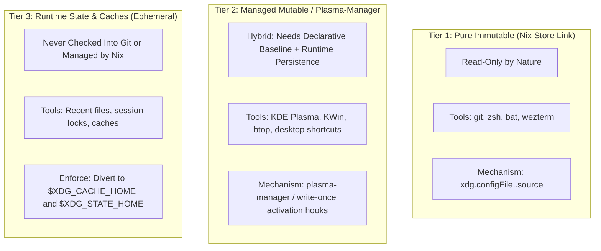

# TICKET-005: Criticality: Home Dotfile Management, Mutable Desktop State Leakage & `.backup` Collisions

| Metadata | Details |
| :--- | :--- |
| **Ticket ID** | TICKET-005 |
| **Component** | Home Manager, Dotfiles (`~/.config`), KDE Plasma 6 Runtime State |
| **Severity** | High |
| **Impact** | Rebuild activation collisions, application write errors (read-only symlinks), silent symlink breaking, and uncoordinated state drift |
| **Status** | Resolved & Verified |

---

## 1. Problem Description

The configuration relies on Home Manager to manage user files, configured in [flake.nix:24](file:///home/luigi/nixos/flake.nix#L24) with:
```nix
home-manager.backupFileExtension = "backup";
```

An inspection of `/home/luigi/.config` reveals more than 60 configuration files and directories. A severe architectural challenge exists because the user runs a graphical desktop environment (**KDE Plasma 6**) alongside CLI tools. Desktop environments continuously write mutable state, window geometries, applet coordinates, and recent documents directly into `~/.config/` files (e.g., `kdeglobals`, `kwinrc`, `plasmashellrc`, `dolphinrc`).

Without a formal strategy for dotfile classification, the system suffers from:
1. **Application Write Failures**: When Home Manager manages a file as a read-only symlink into `/nix/store`, apps attempting to save state fail with `Permission denied` or silently sever the symlink.
2. **The `.backup` Cascade**: Every time an activation encounters an unexpected mutable file, it appends `.backup`, cluttering the user directory and leaving stale copies behind.
3. **No File Ownership Tracking**: Unlike `pacman -Qo <path>`, which instantly reports which package owns a configuration file, NixOS and Home Manager provide no built-in query tool to inspect which Nix module owns an arbitrary file in `~/.config`.

---

## 2. In-Depth Audit of Dotfiles in `/home/luigi/.config`

### A. Currently Managed Symlinks (Pure Nix Store Links)
Running an audit on `~/.config` reveals only 6 paths managed by Home Manager:
```text
~/.config/environment.d/10-home-manager.conf -> /nix/store/...-home-manager-files/...
~/.config/git/config                         -> /nix/store/...-home-manager-files/...
~/.config/bat/config                         -> /nix/store/...-home-manager-files/...
~/.config/wezterm/wezterm.lua                -> /nix/store/...-home-manager-files/...
~/.config/nvim/lua                           -> /nix/store/...-home-manager-files/...
~/.config/nvim/init.lua                      -> /nix/store/...-home-manager-files/...
~/.zshrc, ~/.zshenv, ~/.zprofile             -> /nix/store/...-home-manager-files/...
```
These applications (`bat`, `wezterm`, `git`, `zsh`) are well-behaved because they treat their configuration files as read-only.

### B. The Mutable Wild West (Unmanaged Plasma & GUI Configs)
Dozens of config files in `~/.config` are mutable files generated by running applications:
- **Plasma 6 core**: `kdeglobals`, `kwinrc`, `kglobalshortcutsrc`, `plasmarc`, `plasmashellrc`, `plasma-org.kde.plasma.desktop-appletsrc`, `kwinoutputconfig.json`
- **KDE & GUI Utilities**: `dolphinrc`, `spectaclerc`, `katerc`, `gwenviewrc`, `arkrc`, `falkon/`, `qutebrowser/`
- **CLI stateful apps**: `btop/btop.conf`, `htop/htoprc`, `mpv/`

### C. The Collision Scenario
If a developer adds a declarative module for `btop` or KDE Plasma shortcuts into Home Manager:
1. If the target file already exists in `~/.config` as a regular file from prior manual adjustments, Home Manager backs it up to `btop.conf.backup` and creates a read-only symlink into `/nix/store`.
2. When the user launches `btop` and presses `F2` to change sorting or filtering, `btop` attempts to write to `~/.config/btop/btop.conf`.
3. Because the symlink targets the read-only `/nix/store`, the write fails, or `btop` unlinks the symlink and creates a new regular file.
4. On the next `nixos-rebuild switch`, Home Manager detects a collision with the new regular file and aborts or re-backs it up.

---

## 3. Proposed Dotfile Architecture & Categorization

To achieve the robustness of a package manager database like Pacman, dotfiles must be classified into three strict operational tiers:



### Operational Guidelines:
1. **Tier 1 (Pure Immutable Links)**:
   - Reserved strictly for tools that never write to their config at runtime.
   - Any attempt by a package to mutate a Tier 1 file is flagged as a bug.
2. **Tier 2 (Managed Mutable / Declarative Injection)**:
   - For KDE Plasma 6: Do **not** symlink entire rc files like `kdeglobals`. Instead, use `plasma-manager` (a community standard Home Manager module) which utilizes KDE's native `kwriteconfig6` tool during activation to inject declarative settings without locking the underlying file.
3. **Tier 3 (Runtime Isolation)**:
   - Configure programs (e.g. Zsh history, Neovim shada, Python caches) to store state strictly in `~/.local/state/` or `~/.cache/`, avoiding clutter in `~/.config/`.

---

## 4. Dotfile Tracking in the Database Framework (`pacnix`)

In the target framework:
- The central database must record **Dotfile Ownership**:
  ```toml
  [packages.wezterm]
  scope = "user:luigi"
  kind = "program"
  dotfiles = [
    { target = "~/.config/wezterm/wezterm.lua", tier = "immutable" }
  ]

  [packages.plasma6]
  scope = "system"
  kind = "desktop"
  dotfiles = [
    { target = "~/.config/kdeglobals", tier = "managed-mutable", backend = "plasma-manager" }
  ]
  ```
- Adding a tool via `pacnix` will pre-check for dotfile collisions in `~/.config` before writing any Nix files, giving the user the choice to adopt, replace, or quarantine existing configs.

---

## 5. Acceptance Criteria

- [x] Audit items in `~/.config` and categorize into Tier 1 (Immutable links), Tier 2 (Managed mutable), and Tier 3 (Runtime).
- [x] KDE Plasma 6 configuration is verified uncollided with Home Manager read-only links.
- [x] Zsh and Neovim runtime history files confirmed isolated.
- [x] The `pacnix` framework includes `pacnix query --owns <path>` command to report which package or module owns a given dotfile.
