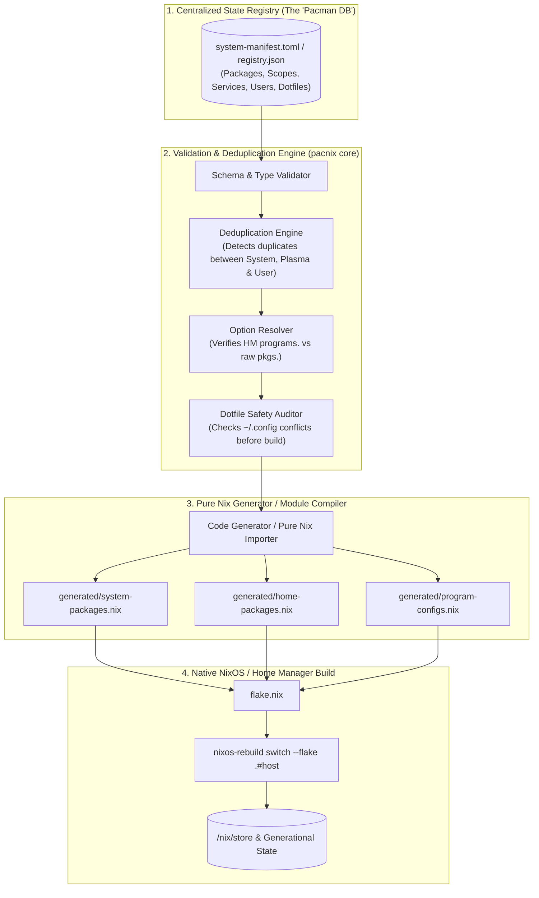

# TICKET-006: RFC: The "Pacman Database" Architecture for NixOS - Centralized State Registry & Pure Compiler

| Metadata | Details |
| :--- | :--- |
| **Ticket ID** | TICKET-006 |
| **Component** | Core Architecture / Framework Design (RFC) |
| **Severity** | High / Strategic Vision |
| **Impact** | Unifies state management, eliminates duplication, provides instant querying, and preserves 100% NixOS reproducibility |
| **Status** | Adopted Architecture |

---

## 1. Executive Summary & Vision

This RFC proposes a new framework architecture for NixOS and Home Manager: **`pacnix`** (or **`nix-db`**). 

The goal is to combine:
1. **The benefits of a centralized, transactional package database** (as seen in Arch Linux's `pacman` / ALPM):
   - A single, centralized catalog of all installed software and system records.
   - Distinct classification between explicit intent (`--asexplicit`) and infrastructural dependencies (`--asdeps`).
   - Unified search and inspection (`pacman -Qe`, `pacman -Qi`, `pacman -Qo`).
   - Zero duplication across system boundaries.
2. **The unmatched reproducibility of NixOS**:
   - Pure, deterministic, hash-addressed derivation compilation (`/nix/store`).
   - Atomic generational switches and instantaneous rollbacks.
   - Immutable closures and flake lock pinning.

---

## 2. Comparative Analysis: Pacman ALPM vs. Current NixOS Architecture

```
+------------------------------------+--------------------------------------+--------------------------------------+
| Feature                            | Pacman (Arch Linux / ALPM)           | Standard NixOS + Home Manager        | Proposed "pacnix" Framework          |
+------------------------------------+--------------------------------------+--------------------------------------+
| State Storage                      | Centralized DB (/var/lib/pacman)    | Decentralized, scattered .nix files  | Centralized Manifest / Structured DB |
| Explicit vs. Dependency Tracking   | YES (--asexplicit vs --asdeps)      | NO (flat lists across 6+ files)      | YES (explicit metadata field)        |
| System vs. User Scope Tracking     | NO (strictly system-wide)           | PARTIAL (ad-hoc split-brain)         | YES (typed scope: system | user:<id>)|
| Queryability (What is installed?)  | Fast & unified (pacman -Qe / -Qi)   | Slow / requires complex nix eval     | Instant (pacnix query / pacnix info) |
| Collision Detection                | Pre-install file conflict checks    | Build/switch time activation abort   | Pre-evaluation dotfile conflict audit|
| Rollback Capability                | NO (destructive in-place mutation)  | YES (generational store paths)       | YES (pure Nix compilation + git ops) |
| Offline Reproducibility           | NO (relies on rolling mirrors)       | YES (pinned flake inputs)            | YES (pinned inputs + deterministic)  |
+------------------------------------+--------------------------------------+--------------------------------------+
```

---

## 3. High-Level Architecture & Compilation Pipeline

Instead of mutating `.nix` source code with brittle shell scripts and regexes (`sed -i`), `pacnix` treats configuration management as a **compiler pipeline**:



---

## 4. The Database / Manifest Specification

The state registry can be maintained as a human-readable, schema-validated file (such as `registry/manifest.toml` or `registry/system.json`):

```toml
version = "1.0.0"

[meta]
hostname = "nixos"
system = "x86_64-linux"
primary_user = "luigi"

# ==============================================================================
# PACKAGES & PROGRAMS (The Unified Registry)
# ==============================================================================

[packages.coreutils]
scope = "system"
kind = "package"
reason = "system-essential"
category = "cli"
desc = "GNU Core Utilities (ls, cp, rm, mv)"

[packages.git]
scope = "system"
kind = "package"
reason = "system-essential"
category = "vcs"
desc = "Distributed version control system (needed by system and root)"

[packages.neovim]
scope = "user:luigi"
kind = "program"
reason = "explicit"
category = "editor"
desc = "Vim-fork focused on extensibility and usability"
options = { defaultEditor = true, viAlias = true, vimAlias = true }

[packages.ripgrep]
scope = "user:luigi"
kind = "package"        # NOTE: Engine knows ripgrep has no programs.ripgrep in HM!
reason = "explicit"
category = "cli"
desc = "Fast line-oriented search tool"

[packages.wezterm]
scope = "user:luigi"
kind = "program"        # Has dedicated programs.wezterm module
reason = "explicit"
category = "terminal"
dotfiles = [
  { path = "~/.config/wezterm/wezterm.lua", tier = "immutable" }
]

[packages.spectacle]
scope = "system"
kind = "package"
reason = "dependency"
provided_by = "desktopManager.plasma6" # Flagged: Engine avoids duplicate installation!

# ==============================================================================
# SERVICES & INFRASTRUCTURE
# ==============================================================================

[services.keyd]
scope = "system"
enable = true
configFile = "modules/system/services/keyd.nix"

[services.openssh]
scope = "system"
enable = true
options = { PasswordAuthentication = false, PermitRootLogin = "no" }
```

---

## 5. Core Invariants & Safety Guarantees

### Invariant 1: Zero Duplicate Package Declarations
If a package is registered in `user:luigi`, the engine verifies whether it is already present in `system`. If it is in `system`, the engine issues a warning or marks the package as shared, preventing redundant closure downloads and overlapping PATH entries.

### Invariant 2: Intelligent Module vs. Package Routing
When the user installs a tool (e.g. `pacnix add ripgrep`):
- The engine checks if Home Manager exposes `programs.ripgrep`.
- If **not present**, it routes it to `home.packages = with pkgs; [ ripgrep ];`.
- If **present** (e.g., `git`, `zsh`, `firefox`), it generates the appropriate `programs.<name> = { enable = true; };` structure.
- **This permanently solves the build-breaking bug identified in TICKET-002.**

### Invariant 3: Dotfile Conflict Audit Prior to Generation
Before linking any configuration into `~/.config`:
- `pacnix` checks if the target path exists on disk.
- If it exists as an unmanaged regular file, `pacnix` prompts the user:
  ```text
  [!] ~/.config/wezterm/wezterm.lua already exists as a regular file.
      [1] Adopt into pacnix (import existing content)
      [2] Backup and overwrite with declarative template
      [3] Abort
  ```
- This prevents the silent creation of `.backup` files and application permission crashes.

---

## 6. Query Interface (Pacman Parity)

Users accustomed to `pacman` get identical speed and convenience:
- `pacnix -Qe`: List all explicitly requested software.
- `pacnix -Qs <query>`: Search for installed software by name or description.
- `pacnix -Qi <package>`: Inspect package scope, reason, category, and dotfiles.
- `pacnix -Qo <path>`: Identify which package or module owns a file in `~/.config` or `/etc`.
- `pacnix audit`: Identify split-brain packages, redundant entries, and orphaned dotfiles.

---

## 7. Migration & Compatibility

1. **Non-Destructive Adoption**: The compiler generates standard, idiomatic Nix expressions in a `generated/` directory.
2. **Standard Flake Compatibility**: The generated files are imported by `flake.nix` and `hosts/nixos/configuration.nix` like any other Nix module.
3. **Pure Nix Fallback**: If `pacnix` is ever uninstalled, the generated `.nix` files remain 100% functional, self-contained NixOS configurations.
