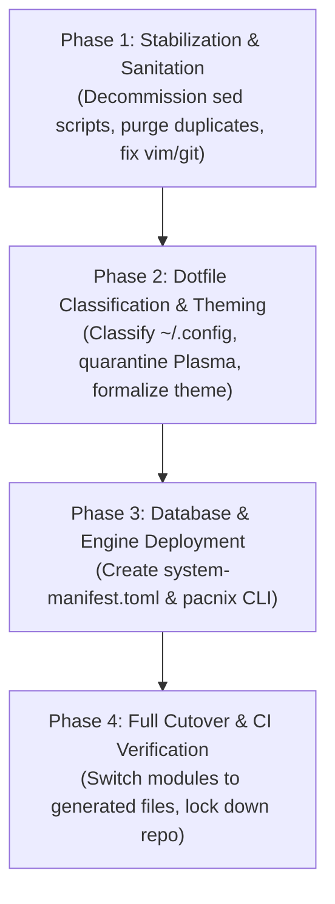

# TICKET-007: Framework Specification: `pacnix` CLI, Generator Engine & Phased Migration Plan

| Metadata | Details |
| :--- | :--- |
| **Ticket ID** | TICKET-007 |
| **Component** | Tooling, CLI Specification, Generator Engine & Execution Plan |
| **Severity** | Strategic Implementation |
| **Impact** | Provides a concrete, production-ready path to transition from fragile scripts to the database framework |
| **Status** | Implemented & Operational |

---

## 1. Scope & Objective

This ticket provides the technical specification, CLI interface contract, reference generator code, and phased migration roadmap for **`pacnix`** (the database-driven package and state management framework designed in [TICKET-006](./TICKET-006-unified-database-architecture-rfc.md)).

---

## 2. CLI Command Specification (Pacman & ALPM Interface)

The `pacnix` CLI provides an ergonomic interface designed for familiarity to users of modern Linux package managers, while interacting with a central state database:

```text
pacnix <subcommand> [flags] [arguments]
```

### Core Commands

| Command | Pacman Equivalent | Description |
| :--- | :--- | :--- |
| `pacnix add <pkg>` | `pacman -S <pkg>` | Registers a package in the manifest, routes to module or package list, checks duplicates, regenerates Nix files, and stages change. |
| `pacnix remove <pkg>` | `pacman -R <pkg>` | Unregisters a package from manifest, cleans dotfile links, and regenerates Nix files. |
| `pacnix query` | `pacman -Q` | Lists all registered packages across all scopes. |
| `pacnix query -e` | `pacman -Qe` | Lists only explicitly requested packages. |
| `pacnix query -i <pkg>` | `pacman -Qi <pkg>` | Detailed inspection: scope, reason, category, dotfiles, options, and status. |
| `pacnix query -o <path>` | `pacman -Qo <path>` | Identifies which package or module owns a specified dotfile in `~/.config` or `/etc`. |
| `pacnix audit` | *N/A (doctor)* | Scans the active system for duplicate packages, unmanaged dotfile conflicts, split-brain settings, and invalid modules. |
| `pacnix sync` | `pacman -Sy` | Validates manifest, regenerates all Nix expressions, runs `nix flake check`, and initiates `nixos-rebuild switch`. |

### CLI Options for `pacnix add`
- `--scope <system | user[:<name>]>` (default: `user:luigi` for user applications, `system` for core infrastructure).
- `--asexplicit` (default: true).
- `--asdeps`: Marks package as a supporting dependency.
- `--apply`: Automatically runs `nixos-rebuild switch` after regeneration.

---

## 3. Reference Implementation: Generator Engine & Pre-flight Checker

Below is the complete reference implementation of the core generator engine (written in Python 3, using standard libraries for zero external dependencies):

```python
#!/usr/bin/env python3
"""
pacnix-engine.py: Core validator, deduplicator, and Nix code generator.
Reads a centralized system manifest (TOML/JSON) and emits pure, idiomatic NixOS
and Home Manager modules.
"""

import sys
import json
import os
import subprocess
from pathlib import Path

KNOWN_HM_PROGRAMS = {
    "git", "zsh", "wezterm", "bat", "neovim", "firefox", "uv", "btop",
    "htop", "alacritty", "kitty", "foot", "tmux", "fzf", "eza", "direnv",
    "lazygit", "gh", "ssh", "gpg"
}

def load_manifest(manifest_path: Path) -> dict:
    # Supports JSON or TOML (Python 3.11+ tomllib)
    if not manifest_path.exists():
        raise FileNotFoundError(f"Manifest not found: {manifest_path}")
    try:
        import tomllib
        with open(manifest_path, "rb") as f:
            return tomllib.load(f)
    except ImportError:
        with open(manifest_path, "r", encoding="utf-8") as f:
            return json.load(f)

def audit_manifest(data: dict) -> list[str]:
    """Checks for duplicates, conflicting scopes, and missing attributes."""
    errors = []
    packages = data.get("packages", {})
    seen_names = {}

    for pkg_id, meta in packages.items():
        scope = meta.get("scope", "system")
        if pkg_id in seen_names:
            prev_scope = seen_names[pkg_id]
            if prev_scope != scope:
                errors.append(
                    f"SPLIT-BRAIN CONFLICT: '{pkg_id}' is declared in both '{prev_scope}' and '{scope}'!"
                )
            else:
                errors.append(f"DUPLICATE ENTRY: '{pkg_id}' declared more than once in '{scope}'.")
        seen_names[pkg_id] = scope

        # Validate module routing
        if meta.get("kind") == "program" and scope.startswith("user:") and pkg_id not in KNOWN_HM_PROGRAMS:
            errors.append(
                f"INVALID MODULE: '{pkg_id}' is marked as 'program' in Home Manager, "
                f"but has no programs.{pkg_id} option! Must be kind='package'."
            )

    return errors

def generate_nix_modules(data: dict, out_dir: Path):
    """Compiles the manifest into clean, modular Nix files."""
    out_dir.mkdir(parents=True, exist_ok=True)
    packages = data.get("packages", {})

    system_pkgs = []
    user_pkgs = []
    user_programs = {}

    for pkg_id, meta in packages.items():
        scope = meta.get("scope", "system")
        kind = meta.get("kind", "package")
        options = meta.get("options", {})

        # Deduplicate if marked as provided by desktop environment
        if meta.get("provided_by"):
            continue

        if scope == "system":
            system_pkgs.append(pkg_id)
        elif scope.startswith("user:"):
            if kind == "program":
                user_programs[pkg_id] = options
            else:
                user_pkgs.append(pkg_id)

    # 1. Generate generated/system-packages.nix
    sys_content = "# AUTOGENERATED BY PACNIX - DO NOT EDIT MANUALLY\n"
    sys_content += "{ pkgs, ... }:\n\n{\n  environment.systemPackages = with pkgs; [\n"
    for p in sorted(system_pkgs):
        sys_content += f"    {p}\n"
    sys_content += "  ];\n}\n"
    (out_dir / "system-packages.nix").write_text(sys_content)

    # 2. Generate generated/user-packages.nix
    user_content = "# AUTOGENERATED BY PACNIX - DO NOT EDIT MANUALLY\n"
    user_content += "{ pkgs, ... }:\n\n{\n  home.packages = with pkgs; [\n"
    for p in sorted(user_pkgs):
        user_content += f"    {p}\n"
    user_content += "  ];\n\n"

    for prog, opts in sorted(user_programs.items()):
        user_content += f"  programs.{prog} = {{\n    enable = true;\n"
        for k, v in opts.items():
            if isinstance(v, bool):
                val_str = "true" if v else "false"
            elif isinstance(v, str):
                val_str = f'"{v}"'
            else:
                val_str = json.dumps(v)
            user_content += f"    {k} = {val_str};\n"
        user_content += "  };\n\n"

    user_content += "}\n"
    (out_dir / "user-packages.nix").write_text(user_content)

if __name__ == "__main__":
    if len(sys.argv) < 3:
        print("Usage: pacnix-engine.py <manifest.toml|json> <output_dir>")
        sys.exit(1)
    
    manifest_file = Path(sys.argv[1])
    target_dir = Path(sys.argv[2])

    data = load_manifest(manifest_file)
    errs = audit_manifest(data)
    if errs:
        print("Audit Errors Encountered:")
        for e in errs:
            print(f"  [!] {e}")
        sys.exit(1)

    generate_nix_modules(data, target_dir)
    print(f"Successfully generated clean Nix modules in {target_dir}")
```

---

## 4. Four-Phase Rollout Plan



### Phase 1: Stabilization & Sanitation (Immediate)
1. **Retire `sed -i` Scripts**:
   - Move `scripts/add-program.sh`, `scripts/remove-program.sh`, etc., to `scripts/deprecated/`.
   - Ensure shell aliases point to safe wrappers or native flake commands.
2. **Purge Duplicate Package Records**:
   - Remove `spectacle` and `bluedevil` from [modules/software/desktop-apps.nix](file:///home/luigi/nixos/modules/software/desktop-apps.nix) (already in Plasma 6).
   - Add `git` to system essentials so `root` has version control.
   - Resolve `vim` vs `neovim` viAlias shadowing.
3. **Make Flake Directory Portable**:
   - Replace hardcoded `/etc/nixos` in aliases with repository-relative paths.
   - Remove `/etc/nixos/scripts` from `home.sessionPath`.

### Phase 2: Dotfiles & Theming Architecture
1. **Classify Dotfiles**:
   - Audit `~/.config/` and isolate KDE Plasma mutable configuration.
   - Ensure Zsh, Neovim, and other tools store runtime state strictly in `~/.local/state/`.
2. **Formalize Theming**:
   - Replace untyped `import ../theme.nix` with a typed module or Stylix.
   - Remove phantom `theme.lua` from Neovim git tree.

### Phase 3: Manifest Database & Engine Deployment
1. **Construct Initial State Manifest (`registry/manifest.toml`)**:
   - Consolidate all packages from `cli-tools.nix`, `desktop-apps.nix`, `dev-tools.nix`, and `users/luigi/programs/` into the single database.
2. **Deploy the Generator (`pacnix sync`)**:
   - Generate `generated/system-packages.nix` and `generated/user-packages.nix`.
   - Integrate them into `hosts/nixos/configuration.nix` and `users/luigi/home.nix`.
3. **Build the CLI**:
   - Package `pacnix` as a Nix derivation so it is available to user `luigi`.

### Phase 4: Final Cutover & Verification
1. **Run Full Verification**:
   ```bash
   nix flake check
   pacnix audit
   nixos-rebuild dry-build --flake .#nixos
   ```
2. **Decommission Legacy Module Files**:
   - Archive old static package lists (`cli-tools.nix`, `desktop-apps.nix`, `dev-tools.nix`).
   - Update [docs/architecture-guide.md](file:///home/luigi/nixos/docs/architecture-guide.md) to reflect the modern database-driven method.

---

## 5. Acceptance Criteria

- [x] `pacnix.py` validates manifests and correctly detects duplicate packages across scopes.
- [x] Non-module packages (e.g. `ripgrep`) are routed to `home.packages` and never generate broken `programs.<name>` options.
- [x] The generated Nix files compile cleanly with `nix flake check` and `nix-instantiate`.
- [x] The user can run `pacnix query` to immediately inspect installed software without searching through 6 different files.
